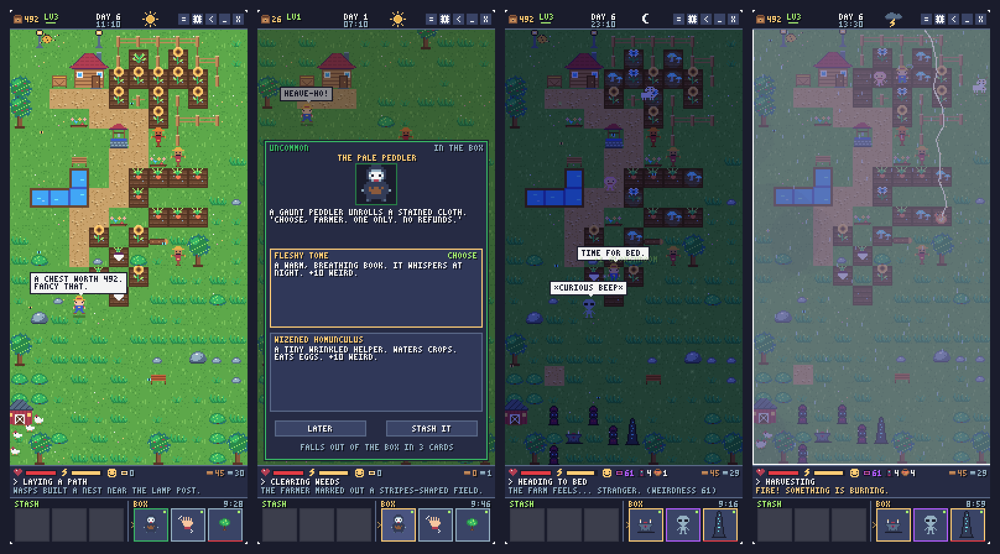
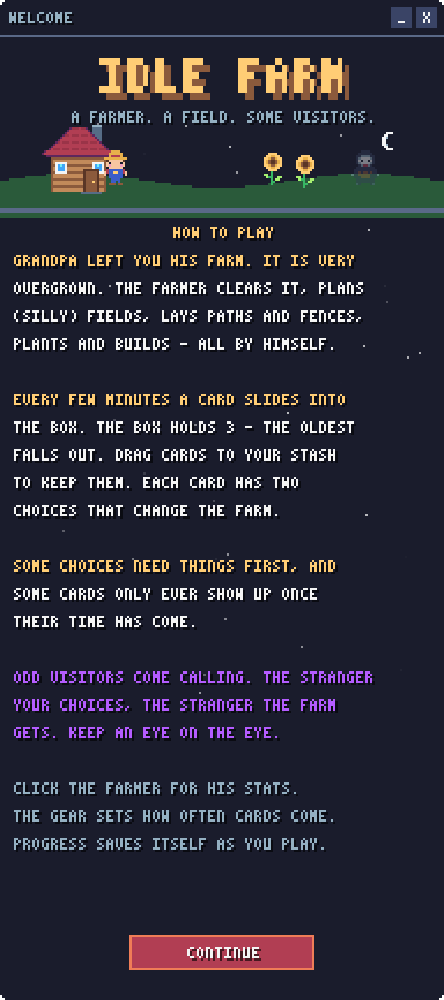
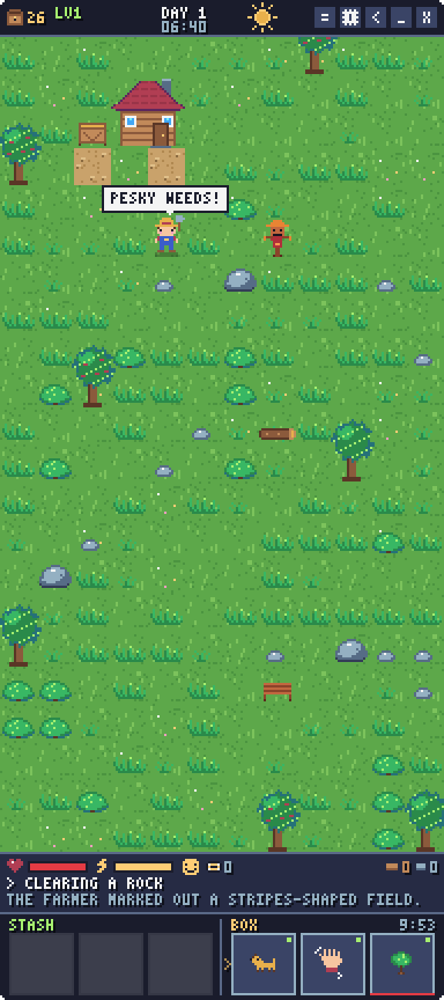
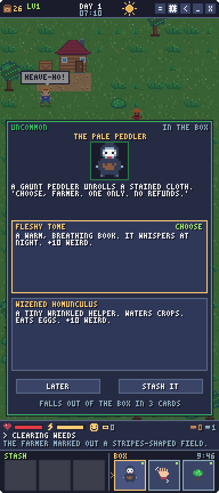
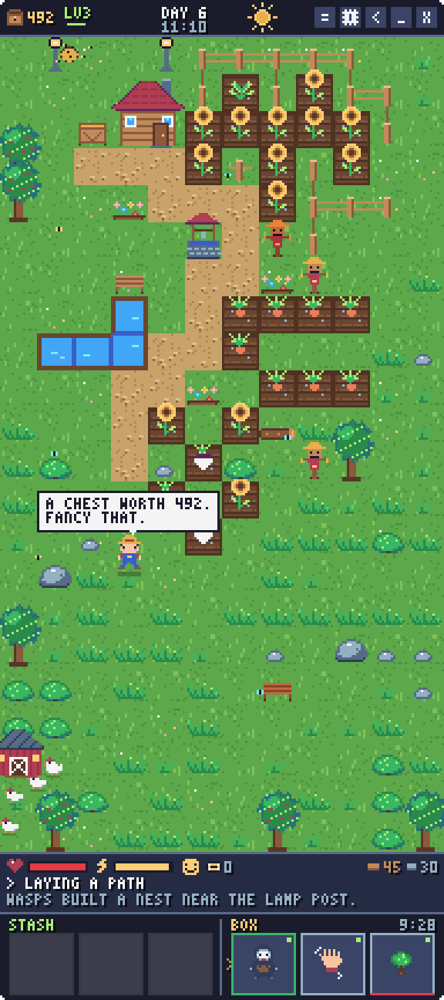
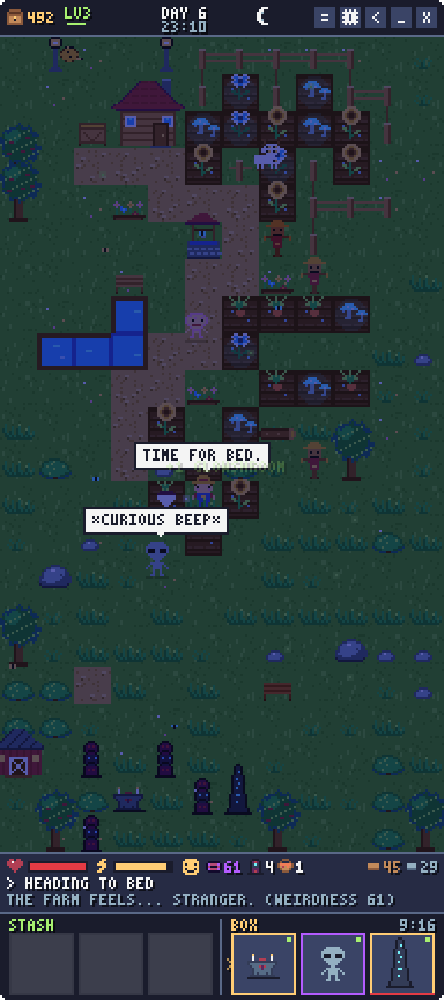
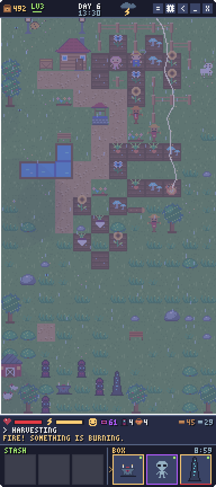
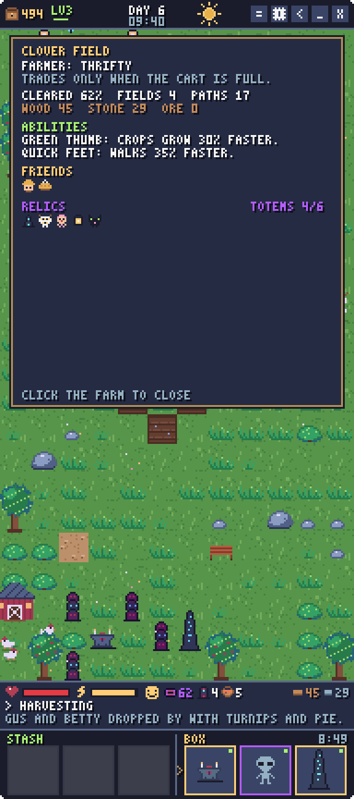
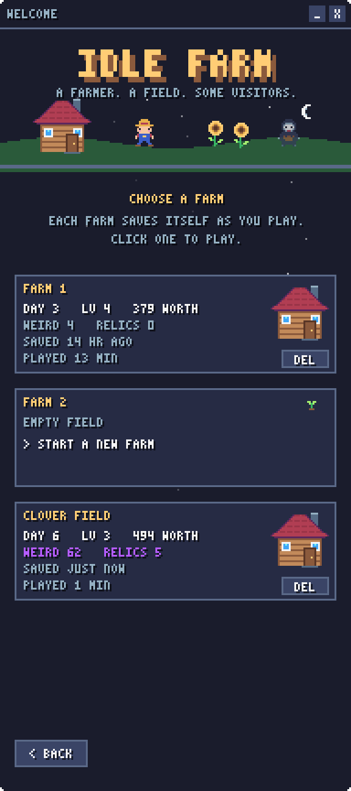

# Idle Farm

**A little farm that runs itself, docked to the side of your screen.**



Your grandpa left you his farm. It's badly overgrown, and it is *definitely* haunted.

You don't control the farmer. He clears brambles, plans fields in silly shapes (hearts, smileys,
checkerboards), lays paths, puts up fences, plants, waters, harvests and builds, all on his own,
in a narrow always-on-top window beside whatever you're actually meant to be doing.

Every few minutes a **choice card** slides into the box. Pick one of its two options and the farm
changes for good: a new field, an orchard, a pond, a coop full of hens, a neighbour who visits
every morning, a new ability for the farmer... or a fleshy book that whispers at night.

---

## Features

- **A farmer with a mind of his own.** He picks his own tasks, chats in speech bubbles, naps when
  he's tired and runs inside when lightning starts. Every farmer gets a quirk: tidy, artsy,
  handy, dreamer, thrifty, or completely obsessed with sunflowers.
- **No two farms alike.** Woodland, rocky, bramble, meadow or marsh. Each farm has its own
  overgrowth, ponds and junk left behind by grandpa.
- **Two-choice cards, no wrong answers.** More than 100 cards across four rarities. Some only turn
  up once their time has come, some come back as follow-ups, and some are gambles.
- **A chest instead of a wallet.** There's no money. The farmer trades his produce for buttons,
  marbles, pocket watches and pearls, and keeps souvenirs from everything that happens: crow
  feathers from shooed crows, sunflower seeds, torn tome pages, star shards from meteorites,
  grandpa's old bottles. How much his chest is worth sets the farm level, and he'll happily tell
  you how rich he's getting.
- **Weather that matters.** Rain, heatwaves and thunderstorms. Lightning starts fires, and a
  lightning rod is a good idea.
- **Critters and visitors.** Crows, rabbits, foxes, boars, snakes and wasps cause trouble.
  Chickens, bees, a watchdog and travelling merchants help out. Then there's the pale peddler,
  the crow king, a frog prince, and a polite voice at the bottom of the well.
- **It gets weird.** A hidden Weirdness meter rises with your choices. The farm takes on a violet
  tint, wisps drift over the fields, glowshrooms and moonflowers glow at night, dark totems
  gather around an altar, and someone keeps knocking on the door.
- **The neighbours are aliens.** Sometimes. An egg falls into the long grass, a saucer comes down,
  a stranger in a long coat asks about land, or something low and many-legged gets into the coop.
  They hatch, grow up, build a glowing village, spread their purple creep, trade, raid, send envoys,
  abduct the farmer (he comes back with an antenna), split, go to war, and one day go home.
- **Giant bugs.** All that strangeness leaks into the local insects. A wasp nest splits open, the
  beehive turns into a heaving mound, or a locust cloud drops a queen. They dig tunnels under the
  fields, spin webs across the paths, strip whole stripes of the farm bare, pollinate (or eat) the
  crops, go to war with the aliens, and when it rains the tunnels cave in into brand new ponds.
- **It never settles down.** The farm, the aliens, the bugs and the wild compete for the land, and
  the tides knock down whoever gets too comfortable. Now and then a cataclysm wipes a whole side
  out: a plague in the alien village, a killing frost for the bugs, a summer that scorches the
  wild bare, or a dark harvest that leaves the farmer with nothing but his house. Everyone comes
  back, eventually.
- **Plays nicely in the background.** Borderless, always on top, docks to either screen edge,
  three save slots that save themselves, and progress keeps ticking while you're away.

## Screenshots

| | | |
|:-:|:-:|:-:|
|  |  |  |
| **Welcome.** How to play, then pick a farm. | **Day one.** Grandpa really let this place go. | **A choice card.** Two options, pick one. |
|  |  |  |
| **A few days in.** Fields, fences, a coop and a chest worth 492. | **Weirdness 61.** Totems, an obelisk, glowing crops and a visitor. | **Storm.** Lightning finds the crops. |
|  |  | |
| **The farmer.** His quirk, abilities, friends and relics. | **Three farms.** Each one saves itself. | |

## How to play

1. Start a farm from one of the three slots.
2. Watch the farmer get to work. Click him to see his stats, abilities, friends and relics.
3. When a card arrives in the **box** (bottom right), click it and pick an option. The box holds
   three cards; when a new one arrives the oldest falls out, so drag the ones you want to keep
   into the **stash** (bottom left).
4. Some options need things first, like three growing sunflowers, a lightning rod or night time.
   Green lines are met, red lines aren't yet.
5. Keep an eye on the eye. That's the Weirdness meter.

The gear button sets how often cards arrive (1 to 60 minutes) and which side of the screen the
window docks to.

## Running it

Idle Farm is built with **Godot 4.7**. Everything, including the pixel art and the font, is
generated in GDScript, so there are no asset files to download.

- **From the editor:** open the project in Godot 4.7+ and press Play. The editor shows the game in
  its Game tab; the borderless, docked window only appears when you run it standalone or export
  it.
- **Windows build:** install the Godot 4.7.2 export templates via **Editor > Manage Export
  Templates > Download and Install**, then run this in PowerShell from the project folder:

  ```powershell
  .\build-game.ps1
  ```

  The script imports resources and exports the game. It looks for the Godot 4.7.2 console executable
  beside the project folder; use `-GodotPath 'D:\Tools\Godot_v4.7.2-stable_win64_console.exe'`
  to select another location. It also works when called from another working directory.

  Double-click `build/IdleFarm.exe` to play. This is a Windows x64 release build with the game
  data embedded: share just the `.exe`; players do not need Godot installed. Debug keys are disabled.

Saves live in `%APPDATA%/Godot/app_userdata/IdleFarm/` on Windows.

## For developers

- [`TODO.md`](TODO.md) is the design doc, architecture map, progress checklist and changelog.
- Card content lives in [`scripts/deck.gd`](scripts/deck.gd), written in a small documented
  mini-language. Adding a card is a single dictionary entry.
- Debug keys (debug builds only): `F1` new card, `F2` fill the box, `F3` random event,
  `F4` 10x speed, `F5` wipe the current slot, `F6` +10 weirdness, `F7` alien arrival, `F8` turn the tides,
  `F9` giant insects, `F10` locust swarm, `F11` cataclysm.
- Headless simulation test: `Godot_v4.7.2-stable_win64.exe --headless --path . -s tests/sim_test.gd -- days=8`.
